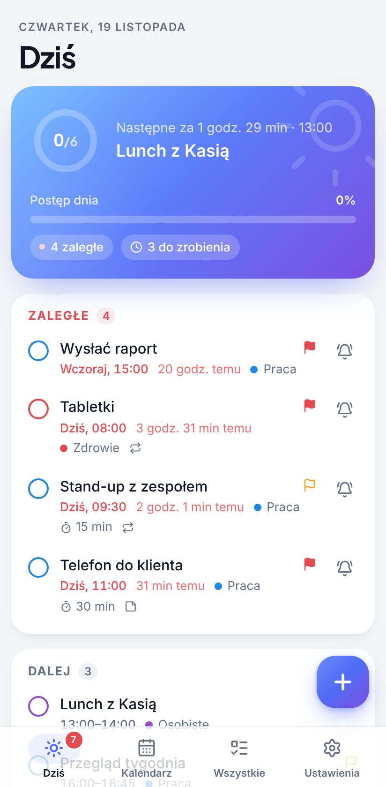
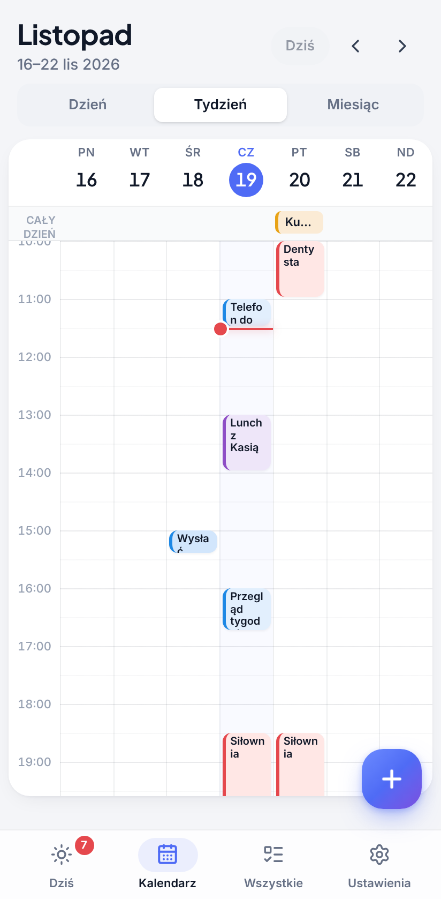
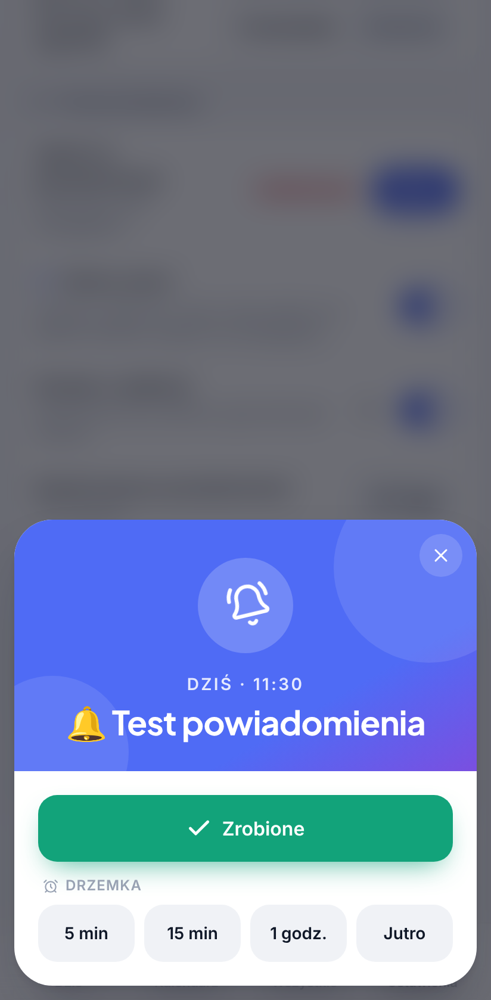
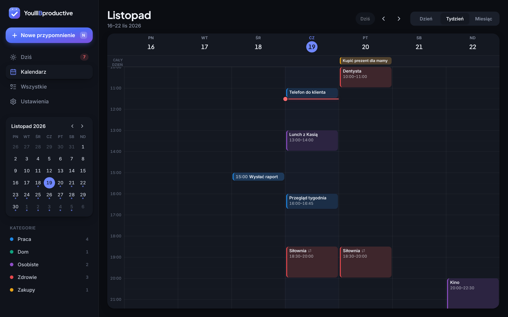

# YoulllBproductive

Przypomnienia + kalendarz po polsku. Jeden kod działa jako **strona w przeglądarce** i jako **aplikacja na Androida (APK)**.

<p align="center">
  
  
  
</p>
<p align="center">
  
</p>

## Co potrafi

- **Przypomnienia**: tytuł, notatka, data i godzina (albo „cały dzień”), czas trwania, priorytet (niski/średni/wysoki), kategoria z kolorem, powtarzanie (codziennie, w dni robocze, co tydzień w wybrane dni, co miesiąc, własne: co N dni/tygodni/miesięcy/lat, z datą końca), oznaczanie jako zrobione (z „Cofnij”), drzemka (5 / 15 / 60 min, jutro).
- **Ekran „Dziś”**: co jest teraz, co dalej, co zaległe, wpisy całodniowe, zrobione dziś i pasek postępu dnia. Na szerokim ekranie także panel „Nadchodzące”.
- **Kalendarz**: widok dnia, tygodnia i miesiąca. Wpisy przeciągasz, żeby zmienić godzinę lub dzień, a dolną krawędź, żeby zmienić czas trwania. Myszą chwytasz od razu, palcem po krótkim przytrzymaniu. Kategorie mają kolory, a na telefonie przesuwasz palcem między dniami, tygodniami i miesiącami. Kliknięcie w pustą godzinę tworzy nowy wpis.
- **Szybkie dodawanie**: jedno pole, np. `jutro 15:00 telefon do klienta`. Aplikacja sama rozpoznaje datę, godzinę, powtarzanie, `#kategorię`, `!priorytet` i czas trwania (ściąga niżej).
- **Powiadomienia**:
  - **Android**: natywne powiadomienia o dokładnej godzinie, także przy zamkniętej aplikacji i po restarcie telefonu. Mają przyciski „Zrobione” i „Drzemka”. Kanał „Alarmy (głośne)” gra własny dźwięk w strumieniu budzika, więc słychać go nawet w trybie cichym.
  - **Przeglądarka**: Notification API i service worker z przyciskami, dźwięk alarmu w pętli, okno alarmu na pełnym ekranie i migający tytuł karty. **Działa tylko przy otwartej karcie** (może być w tle) i aplikacja wyraźnie o tym informuje.
- **Wyszukiwarka i filtry**: po tytule i notatce, kategorii, priorytecie i statusie.
- **Tryb jasny / ciemny**, domyślnie zgodnie z systemem.
- **Eksport i import JSON** (kopia zapasowa; import „połącz” albo „zastąp”).
- Działa offline, a stronę można „zainstalować” jako aplikację (PWA) na komputerze.

## Stos technologiczny

React 19 + TypeScript 7 + Vite 8 + Tailwind CSS 4 · Capacitor 8 (`@capacitor/local-notifications`) · date-fns 4 (locale `pl`) · Dexie 4 (IndexedDB) · Zustand · Motion · Lucide · Vitest

---

## 1. Wersja webowa – uruchomienie

Wymagania: **Node.js 20.19+ lub 22.12+** i npm.

```bash
npm install
npm run dev          # http://localhost:5173 (także z telefonu w tej samej sieci)
```

Inne polecenia:

```bash
npm test             # testy parsera i powtarzania (Vitest)
npm run build        # sprawdzenie typów + build produkcyjny do dist/
npm run preview      # podgląd buildu: http://localhost:4173
```

> Service worker (offline i przyciski w powiadomieniach) działa tylko w buildzie produkcyjnym (`npm run build && npm run preview`) albo na hostingu. W `npm run dev` jest wyłączony.

## 2. Budowanie APK na Androida

### Czego potrzebujesz

| Narzędzie | Wersja | Skąd |
| --- | --- | --- |
| JDK | **21** | [Adoptium Temurin 21](https://adoptium.net/) lub JDK dołączony do Android Studio |
| Android SDK | platforma **android-36**, build-tools **36.0.0**, platform-tools | Android Studio (SDK Manager) albo same command-line tools |

**Najprościej:** zainstaluj [Android Studio](https://developer.android.com/studio). Zawiera JDK i SDK. Przy pierwszym uruchomieniu wybierz „Standard”, a potem w *Settings → Languages & Frameworks → Android SDK* zaznacz **Android 16 (API 36)**.

**Bez Android Studio** (np. Linux lub serwer): pobierz *Command line tools only* ze strony Android Studio, rozpakuj do `~/android-sdk/cmdline-tools/latest` i uruchom:

```bash
export ANDROID_HOME=$HOME/android-sdk
$ANDROID_HOME/cmdline-tools/latest/bin/sdkmanager --licenses
$ANDROID_HOME/cmdline-tools/latest/bin/sdkmanager "platform-tools" "platforms;android-36" "build-tools;36.0.0"
```

Gradle wskazuje SDK przez zmienną `ANDROID_HOME` albo plik `android/local.properties`:

```properties
sdk.dir=/Users/ty/Library/Android/sdk        # macOS
# sdk.dir=C\:\\Users\\Ty\\AppData\\Local\\Android\\Sdk   (Windows)
```

### Build debug APK

```bash
npm install
npm run build              # web → dist/
npx cap sync android       # kopiuje dist/ i wtyczki do projektu Androida
cd android
./gradlew assembleDebug    # Windows: gradlew.bat assembleDebug
```

To samo jednym poleceniem: `npm run android:apk`.

Gotowy plik: **`android/app/build/outputs/apk/debug/app-debug.apk`**

> Pierwszy build trwa kilka minut, bo Gradle pobiera zależności. Kolejne trwają kilkanaście sekund.
> Projekt możesz też otworzyć w Android Studio: `npx cap open android`, a potem ▶ Run.

### APK bez instalowania czegokolwiek (GitHub Actions)

Workflow `.github/workflows/android-apk.yml` buduje debug APK przy każdym pushu. Wejdź w repozytorium na GitHubie → **Actions** → ostatnie uruchomienie „Android APK (debug)” → sekcja **Artifacts** → pobierz `YoulllBproductive-debug-apk` (ZIP z plikiem `app-debug.apk`). Workflow możesz też uruchomić ręcznie przyciskiem *Run workflow*.

### Wersja do publikacji (release)

Debug APK wystarczy do własnego telefonu. Do Sklepu Play potrzebny jest podpisany **AAB**:

```bash
keytool -genkey -v -keystore youlllb.keystore -alias youlllb -keyalg RSA -keysize 2048 -validity 10000
cd android && ./gradlew bundleRelease
```

Podpisywanie skonfiguruj w `android/app/build.gradle` (`signingConfigs`) albo w Android Studio: *Build → Generate Signed App Bundle / APK*. Nie wrzucaj pliku `.keystore` do repozytorium.

## 3. Instalacja APK na telefonie

**Sposób A, przez plik:**
1. Skopiuj `app-debug.apk` na telefon (kabel USB, Google Drive, wiadomość do siebie).
2. Otwórz plik w menedżerze plików i zezwól na instalację z tego źródła (*Instaluj nieznane aplikacje*).
3. Jeśli Play Protect ostrzega o nieznanej aplikacji, wybierz „Zainstaluj mimo to”. To normalne dla APK spoza Sklepu.

**Sposób B, przez USB (adb):**
1. Na telefonie włącz *Opcje programisty*: 7 razy stuknij „Numer kompilacji” w *Informacje o telefonie*. Potem włącz *Debugowanie USB*.
2. Podłącz telefon i uruchom:
   ```bash
   adb install -r android/app/build/outputs/apk/debug/app-debug.apk
   ```

**Po pierwszym uruchomieniu:**
- zgódź się na **powiadomienia** (Android 13+ pyta o to przy pierwszym włączeniu),
- jeśli aplikacja poprosi o **dokładne alarmy** (*Alarmy i przypomnienia*), włącz je. Na Androidzie 13+ zwykle są przyznane automatycznie,
- na telefonach Xiaomi, Huawei, OnePlus i Samsung wyłącz dla aplikacji **optymalizację baterii** (*Ustawienia → Aplikacje → YoulllBproductive → Bateria → Bez ograniczeń*). Inaczej system może blokować alarmy,
- w *Ustawienia → Powiadomienia* w aplikacji użyj **Wyślij testowe powiadomienie** i zablokuj telefon. Po 5 s powinien zadzwonić alarm.

## 4. Darmowy hosting strony (Vercel lub Netlify)

Oba serwisy dają HTTPS, który jest wymagany do powiadomień i service workera. W repozytorium są gotowe pliki `vercel.json` i `netlify.toml`.

### Vercel
1. Wrzuć projekt na GitHub.
2. Wejdź na [vercel.com](https://vercel.com) → *Add New → Project* → wybierz repozytorium.
3. Vercel sam rozpozna Vite (build: `npm run build`, katalog: `dist`) → *Deploy*.

Albo z terminala: `npx vercel` (podgląd) i `npx vercel --prod` (produkcja).

### Netlify
1. [app.netlify.com](https://app.netlify.com) → *Add new site → Import an existing project* → GitHub → repozytorium.
2. Ustawienia zostaną wczytane z `netlify.toml` (build `npm run build`, publish `dist`) → *Deploy*.

Albo bez Gita: `npm run build`, a potem przeciągnij folder `dist/` na [app.netlify.com/drop](https://app.netlify.com/drop).
Z terminala: `npx netlify-cli deploy --prod --dir=dist`.

Routing działa na `#/…`, więc nie trzeba konfigurować przekierowań SPA.

---

## Jak działają powiadomienia

| | Android (APK) | Przeglądarka |
| --- | --- | --- |
| Gdy aplikacja jest zamknięta | ✅ tak, o dokładnej godzinie | ❌ nie, tylko przy otwartej karcie |
| Po restarcie telefonu | ✅ alarmy są przywracane | – |
| Przyciski w powiadomieniu | Zrobione · Drzemka 15 min · 1 godz. | Zrobione · Drzemka 15 min |
| „Głośny alarm” | kanał z dźwiękiem w strumieniu budzika (słychać w trybie cichym) | dźwięk w pętli do 1 min + okno alarmu na pełnym ekranie |
| Uprawnienia | `POST_NOTIFICATIONS` (13+), `SCHEDULE_EXACT_ALARM` (12), `USE_EXACT_ALARM` (13+), `RECEIVE_BOOT_COMPLETED` | zgoda na powiadomienia w przeglądarce |

- Na Androidzie aplikacja planuje alarmy na **30 dni do przodu** (do 300 naraz) i odświeża harmonogram po każdej zmianie i przy każdym otwarciu.
- Przełącznik **Głośny alarm** w ustawieniach wybiera kanał: „Alarmy (głośne)” albo „Przypomnienia” (zwykły dźwięk). Dźwięk i wibracje każdego kanału zmienisz też w ustawieniach systemu Android.
- `USE_EXACT_ALARM` jest przyznawane automatycznie aplikacjom typu budzik, kalendarz lub przypomnienia. Przy publikacji w Sklepie Play trzeba to uzasadnić w deklaracji uprawnień. W tej aplikacji to podstawowa funkcja.
- **Synchronizacji między urządzeniami jeszcze nie ma.** Przypomnienie dodane na telefonie dzwoni na telefonie, a dodane na stronie dzwoni na stronie. Dane przeniesiesz eksportem i importem JSON. Warstwa danych jest przygotowana pod Supabase (patrz niżej).

## Szybkie dodawanie – ściąga

| Wpisz | Rozpozna |
| --- | --- |
| `jutro 15:00 telefon do klienta` | jutro, 15:00 |
| `w piątek o 8 wieczorem kino` | najbliższy piątek, 20:00 |
| `w przyszły wtorek dentysta` | wtorek w przyszłym tygodniu, cały dzień |
| `za 2 godziny wyjąć pranie` · `za 15 min` · `za 3 dni` · `za tydzień` | względnie |
| `15.12 urodziny` · `3 stycznia` · `2027-02-01 10:00` | konkretna data |
| `rano` · `w południe` · `po południu` · `wieczorem` | 9:00 · 12:00 · 15:00 · 19:00 |
| `codziennie 8:00 tabletki` · `w dni robocze` · `co tydzień` · `co miesiąc` · `co rok` | powtarzanie |
| `co poniedziałek` · `co wtorek i czwartek o 18` · `co 2 tygodnie` · `co 3 dni` | powtarzanie w wybrane dni / co N |
| `13:00-14:30` · `od 9 do 11` · `przez 45 min` · `przez godzinę` | czas trwania |
| `#praca` | kategoria (nowa zostanie utworzona) |
| `!` lub `!!!` · `!!` · `!n` · `pilne` | priorytet wysoki · średni · niski · wysoki |

Godzina, która już minęła, oznacza jutro (np. `o 8` wpisane o 10:00).

## Skróty klawiaturowe (komputer)

`N` lub `Ctrl/⌘+K` – nowe przypomnienie · `1`–`4` – ekrany · `/` – szukaj (lista) · w kalendarzu: `←` `→` – poprzedni/następny okres, `T` – dziś, `D`/`W`/`M` – dzień/tydzień/miesiąc · `Esc` – zamknij okno

## Dane i przyszła synchronizacja (Supabase)

- Dane leżą lokalnie w **IndexedDB** (Dexie). W APK to IndexedDB w WebView aplikacji.
- UI nie zna Dexie. Korzysta z interfejsu `DataRepository` (`src/data/repository.ts`) i z akcji w `src/data/actions.ts`.
- Każdy rekord ma `id` (UUID), `createdAt`, `updatedAt` i `deletedAt`. Usunięcie zostawia „nagrobek” (tombstone), więc usunięcia też da się synchronizować.
- `src/data/sync.ts` zawiera gotowy silnik synchronizacji „ostatni zapis wygrywa” i interfejs `SyncAdapter`. Żeby dodać Supabase:
  1. utwórz tabele `reminders` i `categories` z kolumnami jak w `src/lib/types.ts` (+ `user_id`) i włącz RLS (`user_id = auth.uid()`),
  2. napisz `SupabaseSyncAdapter` (`pull`: `select … where updated_at > since`, `push`: `upsert`),
  3. po zalogowaniu wywołuj `syncOnce(repository, adapter)` przy starcie, po zmianach (z opóźnieniem) i co kilka minut. Ewentualnie dołóż Supabase Realtime.

## Struktura projektu

```
src/
  lib/            typy, daty (pl), powtarzanie, parser szybkiego dodawania, kolory, dźwięk, motyw
  data/           Dexie, repozytorium, akcje, synchronizacja (szkielet), kopia JSON, dane przykładowe
  notifications/  wyliczanie alarmów, Android (local-notifications), przeglądarka (Notification API + SW)
  components/     układ (panel boczny / dolna nawigacja), wiersze, edytor, szybkie dodawanie, alarm
  components/calendar/  siatka godzin, miesiąc, przeciąganie, swipe
  screens/        Dziś, Kalendarz, Wszystkie, Ustawienia
public/           ikony, manifest PWA, sw.js, dźwięk alarmu
android/          projekt Android (Capacitor) – MainActivity tworzy głośny kanał alarmów
scripts/          generator dźwięku alarmu i ikon (Playwright)
```

Ikony, ekran startowy i dźwięk generujesz od nowa poleceniem `npm run gen:assets` (wymaga Playwright z Chromium).

## Rozwiązywanie problemów

- **`SDK location not found`**: ustaw `ANDROID_HOME` albo utwórz `android/local.properties` z `sdk.dir=…`.
- **`Unsupported class file major version` / zła wersja Javy**: użyj JDK 21 (`java -version`). W Android Studio: *Settings → Build Tools → Gradle → Gradle JDK*.
- **Brak powiadomień na Androidzie**: sprawdź zgodę na powiadomienia, dokładne alarmy i optymalizację baterii, a potem użyj „Wyślij testowe powiadomienie”.
- **Brak dźwięku w przeglądarce**: przeglądarki blokują dźwięk, dopóki nie klikniesz czegoś na stronie. Wystarczy jedno kliknięcie po otwarciu karty.
- **Zmiany w kodzie nie widać w APK**: po każdej zmianie uruchom `npm run build && npx cap sync android`.
